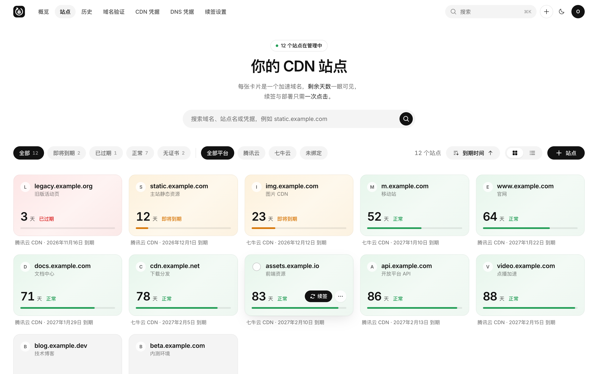
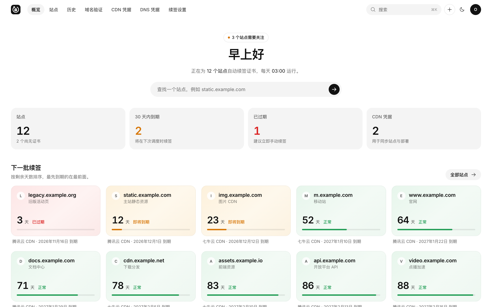
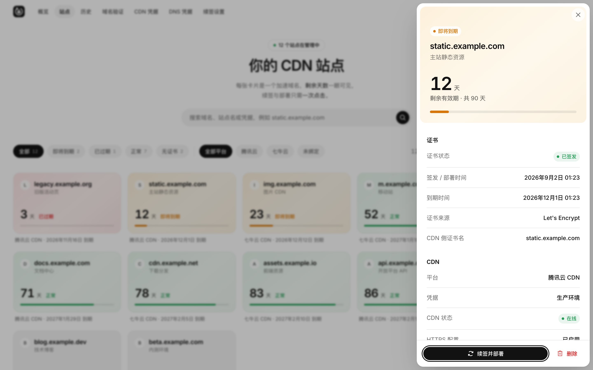
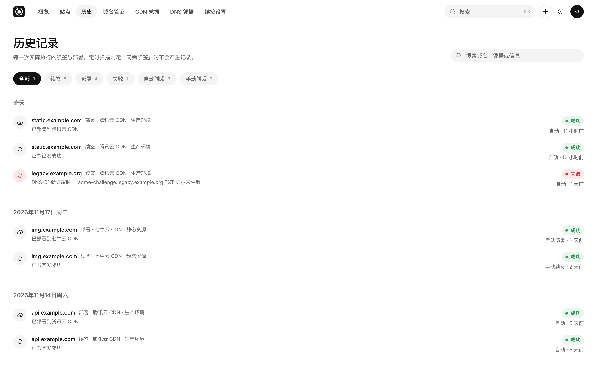
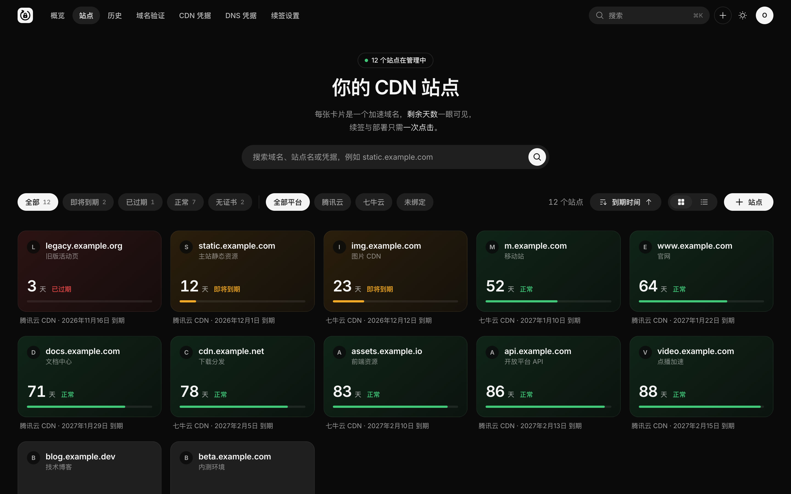
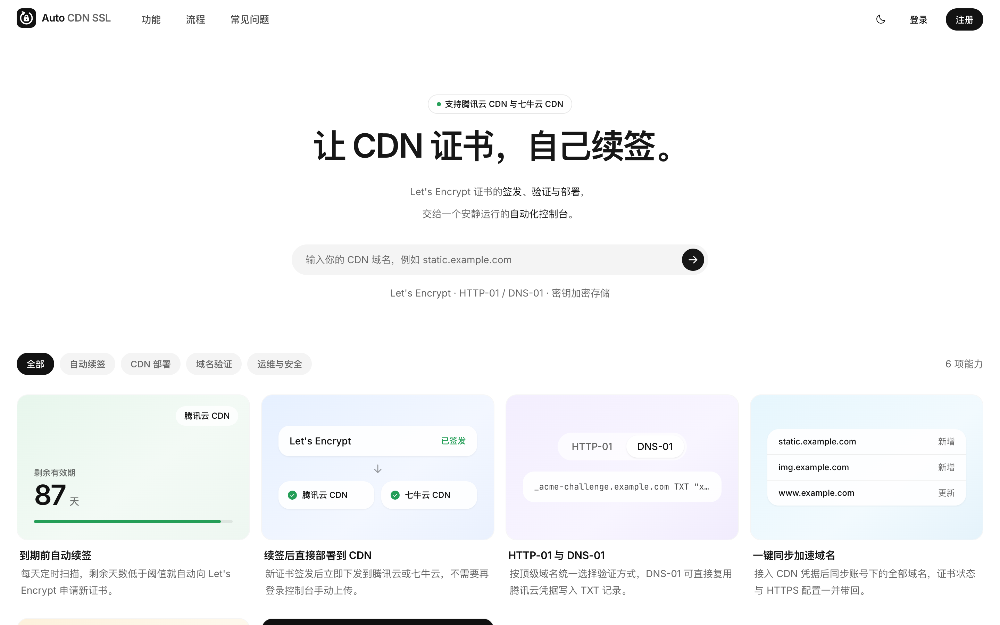

<div align="center">


# Auto CDN SSL

**CDN certificates that renew themselves.**

A self-hosted console that issues, validates and deploys Let's Encrypt certificates for your CDN domains — quietly, on schedule.

[Live demo](https://auto-cdn-ssl.littleor.cn) · [Deployment guide](./docs/DEPLOY_PM2_NGINX.md) · English | [中文](./README.md)

</div>



## Why

With many CDN domains, certificates become a reliability risk:

- expiry dates are scattered across cloud consoles and easy to miss;
- renewing by hand and uploading to the CDN is tedious and error-prone;
- when something fails, it is unclear whether validation, issuance or deployment broke.

Auto CDN SSL turns the certificate lifecycle into an **observable pipeline**: renew before expiry → deploy to the CDN automatically → keep a record of every step.

## Features

| | |
| --- | --- |
| **Auto renewal** | A daily scan renews certificates whose remaining validity drops below a threshold; run time and threshold are configurable |
| **Auto deployment** | Freshly issued certificates are pushed to **Tencent Cloud CDN / Qiniu CDN**, or use "renew & deploy" on demand |
| **Domain validation** | Choose **HTTP-01** or **DNS-01** per apex domain; DNS-01 manages `_acme-challenge` TXT records (Tencent Cloud DNS, CDN credentials reusable) |
| **Site sync** | Import every CDN domain from a provider account, including HTTPS status and current certificate metadata |
| **Site management** | Card and list views, filter and sort by expiry status and platform; renew or delete sites one by one or in bulk |
| **History** | Renewals and deployments grouped by day, scheduled vs manual triggers, one-click copy of failure details |
| **Security** | Provider credentials and private keys encrypted at rest with AES-256-GCM (`DATA_ENCRYPTION_KEY`) |
| **Console** | `⌘K` search across sites and pages; light by default with optional dark mode; multi-user sign-up with email verification |

## Screenshots

<table>
  <tr>
    <td width="50%"><p align="center">Dashboard: what needs attention and what renews next</p></td>
    <td width="50%"><p align="center">Site detail: certificate, CDN status, one-click renew</p></td>
  </tr>
  <tr>
    <td width="50%"><p align="center">History of every renewal and deployment</p></td>
    <td width="50%"><p align="center">Optional dark mode</p></td>
  </tr>
  <tr>
    <td colspan="2"><p align="center">Landing page</p></td>
  </tr>
</table>

> Screenshots use demo data (`example.com` domains).

## Quick start

> For a quick local run. For production, see the [deployment guide](./docs/DEPLOY_PM2_NGINX.md).

**Prerequisites**: Node.js 20+, MySQL 8+ (or compatible), an SMTP server (for sign-up email verification)

```bash
# 1. Install dependencies
yarn install

# 2. Configure environment
cp apps/backend/.env.example apps/backend/.env
cp apps/frontend/.env.example apps/frontend/.env

# 3. Start backend and frontend together
yarn dev
```

The backend `.env` needs at least: `MYSQL_*`, `SMTP_*` + `FROM_EMAIL`, `WEB_BASE_URL`, `JWT_SECRET`, `DATA_ENCRYPTION_KEY`.

- Console: <http://localhost:5173>
- API health: <http://localhost:4000/health>

## How it works

1. **Sign up** and verify your email.
2. **Connect credentials**: add Tencent Cloud or Qiniu keys under "CDN credentials" and click "Sync sites" to import your CDN domains. Create a separate DNS credential under "DNS credentials" if needed.
3. **Configure validation** per apex domain under "Domain validation":
   - HTTP-01: port 80 of the domain must serve `/.well-known/acme-challenge/*`;
   - DNS-01 (recommended): pick a Tencent Cloud credential; TXT records are written and awaited automatically, no port 80 needed.
4. **Let the scheduler run**: confirm the daily run time and threshold under "Renewal settings". Certificates are then renewed and deployed before they expire; you can still click "Renew" on any site card.

## Production

Serve the frontend with Nginx and keep the backend running under a process manager — see [`docs/DEPLOY_PM2_NGINX.md`](./docs/DEPLOY_PM2_NGINX.md).

Operational notes:

- **Run a single backend instance**: the scheduler lives in the backend; multiple instances would renew twice.
- **Persist the ACME account**: `apps/backend/data/acme-account.json` holds the ACME account key — persist and back it up.
- **Don't rotate keys casually**: changing `DATA_ENCRYPTION_KEY` makes stored secrets undecryptable; changing `JWT_SECRET` signs everyone out.
- **Start with ACME staging**: point `ACME_DIRECTORY_URL` to Let's Encrypt staging first, then switch to production to avoid rate limits.

## Tech stack

- Backend: Fastify · MySQL · acme-client · node-cron (`apps/backend`)
- Frontend: React · Vite · Tailwind CSS · Radix UI (`apps/frontend`)

## Docs

- Deployment: [`docs/DEPLOY_PM2_NGINX.md`](./docs/DEPLOY_PM2_NGINX.md)
- Product requirements (Chinese): [`docs/PRD.md`](./docs/PRD.md)

## Contributing

Issues and PRs are welcome — especially new DNS / CDN providers and deployment options.
