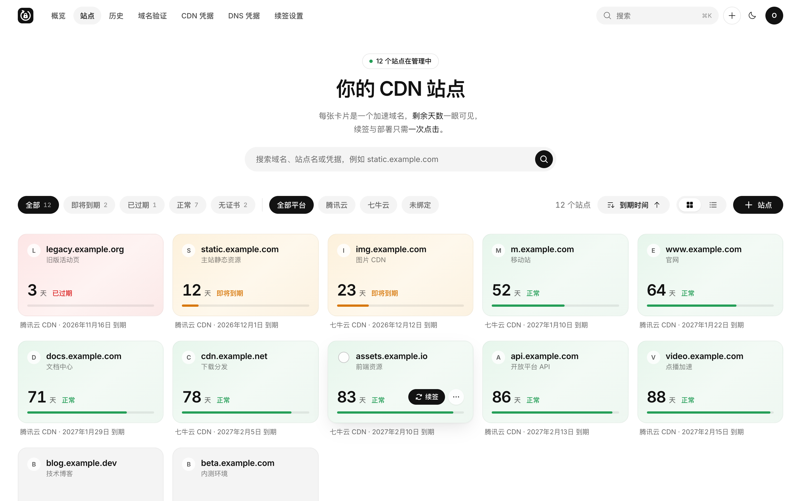
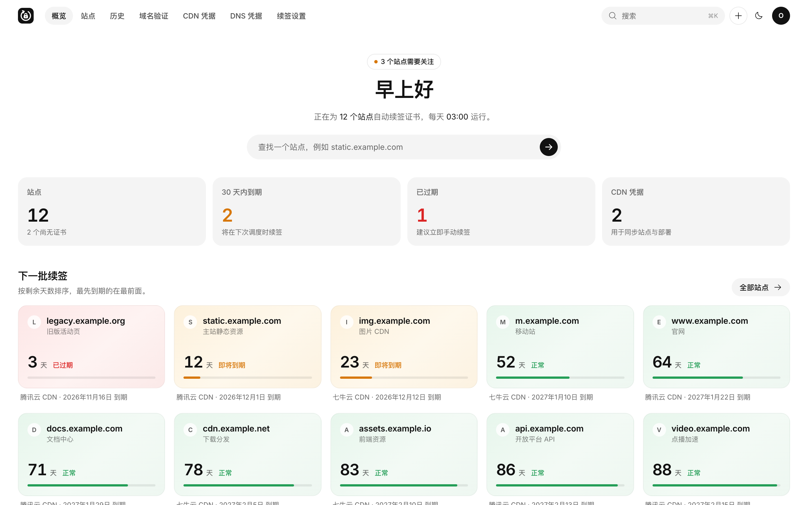
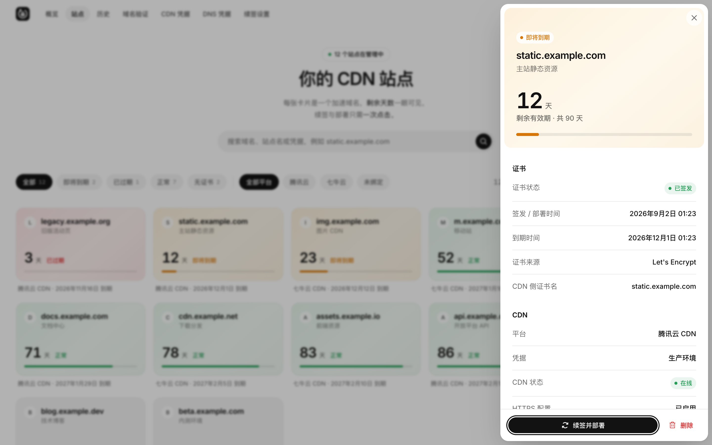
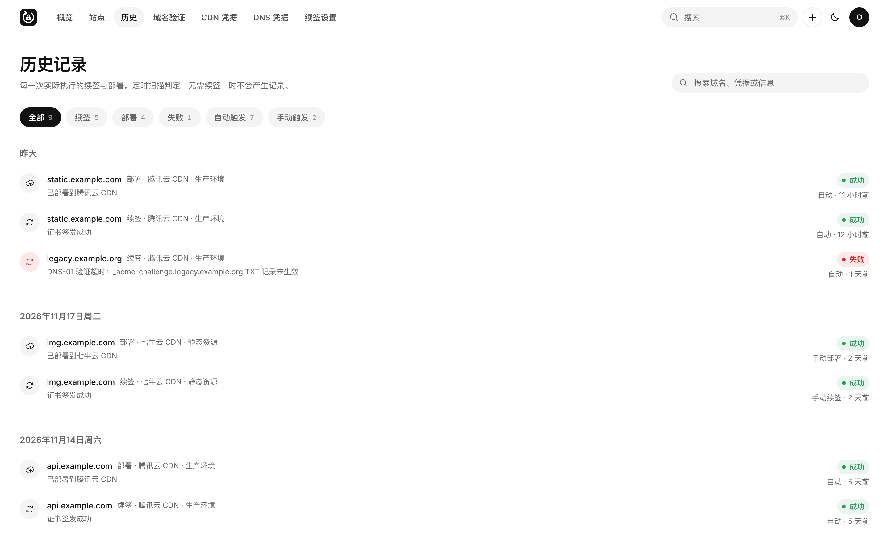
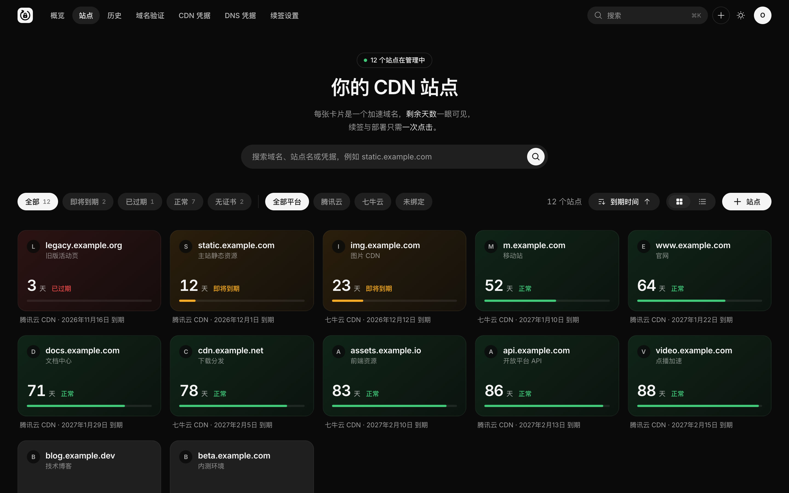
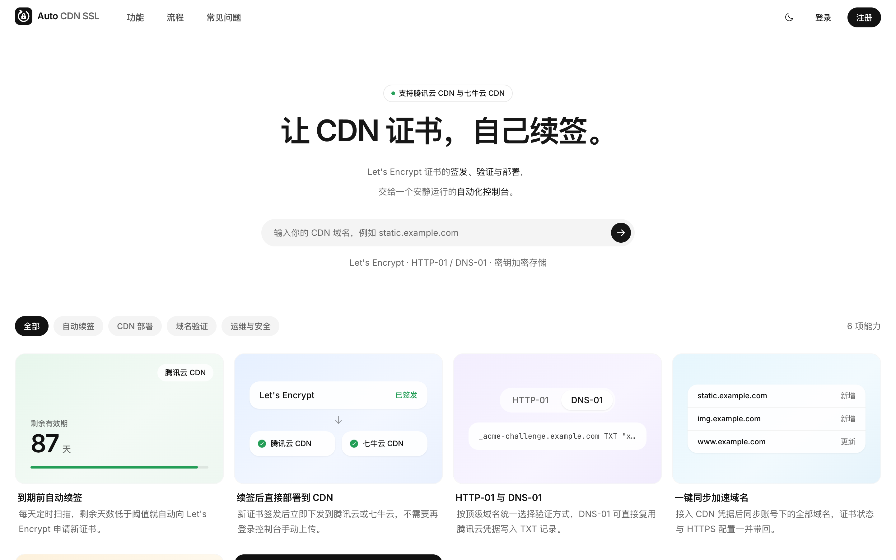

<div align="center">


# Auto CDN SSL

**让 CDN 证书，自己续签。**

Let's Encrypt 证书的签发、验证与部署，交给一个安静运行的自托管控制台。

[在线体验](https://auto-cdn-ssl.littleor.cn) · [部署文档](./docs/DEPLOY_PM2_NGINX.md) · 中文 | [English](./README.en.md)

</div>



## 为什么需要它

CDN 域名一多，证书就成了稳定性隐患：

- 到期时间分散在不同云平台，很难提前发现；
- 手动续签、再上传到 CDN，步骤多且容易遗漏；
- 出错时说不清是验证、签发还是部署环节的问题。

Auto CDN SSL 把证书生命周期变成一条**可观测的流水线**：到期前自动续签 → 续签成功后自动部署到 CDN → 每一步都留下记录。

## 功能

| | |
| --- | --- |
| **自动续签** | 每天定时扫描，剩余天数低于阈值即向 Let's Encrypt 申请新证书；执行时间与提前天数可配置 |
| **自动部署** | 新证书签发后直接下发到 **腾讯云 CDN / 七牛云 CDN**，也可随时手动「续签并部署」 |
| **域名验证** | 按顶级域名统一选择 **HTTP-01** 或 **DNS-01**；DNS-01 自动写入 `_acme-challenge` TXT（腾讯云 DNS，可复用 CDN 凭据） |
| **站点同步** | 接入 CDN 凭据后一键同步账号下全部加速域名，HTTPS 状态与当前证书信息一并带回 |
| **站点管理** | 卡片 / 列表两种视图，按到期状态与平台筛选、排序；支持单个或批量续签、删除站点 |
| **历史留痕** | 续签与部署按天归档，区分自动 / 手动触发，失败原因一键复制 |
| **安全设计** | 云厂商凭据与证书私钥使用 AES-256-GCM 加密存储（`DATA_ENCRYPTION_KEY`） |
| **控制台体验** | `⌘K` 全局搜索站点与页面；默认亮色，可切换暗色模式；多用户注册与邮箱验证 |

## 截图

<table>
  <tr>
    <td width="50%"><p align="center">概览：需要关注的站点与下一批续签</p></td>
    <td width="50%"><p align="center">站点详情：证书、CDN 状态与一键续签</p></td>
  </tr>
  <tr>
    <td width="50%"><p align="center">历史记录：每一次续签与部署</p></td>
    <td width="50%"><p align="center">可选的暗色模式</p></td>
  </tr>
  <tr>
    <td colspan="2"><p align="center">官网首页</p></td>
  </tr>
</table>

> 截图使用演示数据（`example.com` 系列域名）。

## 快速开始

> 用于本地快速跑通流程；生产环境请参考 [部署文档](./docs/DEPLOY_PM2_NGINX.md)。

**依赖**：Node.js 20+、MySQL 8+（或兼容服务）、SMTP（注册邮箱验证）

```bash
# 1. 安装依赖
yarn install

# 2. 配置环境变量
cp apps/backend/.env.example apps/backend/.env
cp apps/frontend/.env.example apps/frontend/.env

# 3. 同时启动前后端
yarn dev
```

后端 `.env` 至少需要填写：`MYSQL_*`、`SMTP_*` + `FROM_EMAIL`、`WEB_BASE_URL`、`JWT_SECRET`、`DATA_ENCRYPTION_KEY`。

- 控制台：<http://localhost:5173>
- API 健康检查：<http://localhost:4000/health>

## 使用流程

1. **注册登录**：完成邮箱验证后进入控制台。
2. **接入凭据**：在「CDN 凭据」添加腾讯云或七牛云密钥，点击「同步站点」导入加速域名；如需独立的 DNS 账号，可在「DNS 凭据」中新建。
3. **配置验证**：在「域名验证」按顶级域名选择方式。
   - HTTP-01：域名的 80 端口需能访问 `/.well-known/acme-challenge/*`；
   - DNS-01（推荐）：选择腾讯云凭据，系统自动写入 TXT 并等待生效，不依赖 80 端口。
4. **交给调度器**：在「续签设置」确认每日运行时间与提前天数；之后到期前会自动续签并部署。需要时也可以在站点卡片上手动「续签」。

## 生产部署

推荐「Nginx 托管前端静态资源 + 进程守护运行后端」，完整步骤见 [`docs/DEPLOY_PM2_NGINX.md`](./docs/DEPLOY_PM2_NGINX.md)。

运行与安全注意：

- **只运行一个后端实例**：调度器内置在后端，多实例会重复续签。
- **持久化 ACME 账号**：`apps/backend/data/acme-account.json` 保存 ACME 账号私钥，务必持久化并备份。
- **不要随意轮换密钥**：更换 `DATA_ENCRYPTION_KEY` 会导致历史数据无法解密；更换 `JWT_SECRET` 会使已签发的登录态失效。
- **先用 staging 联调**：初次部署把 `ACME_DIRECTORY_URL` 指向 Let's Encrypt staging，确认无误后再切换 production，避免触发限额。

## 技术栈

- 后端：Fastify · MySQL · acme-client · node-cron（`apps/backend`）
- 前端：React · Vite · Tailwind CSS · Radix UI（`apps/frontend`）

## 文档

- 生产部署：[`docs/DEPLOY_PM2_NGINX.md`](./docs/DEPLOY_PM2_NGINX.md)
- 产品需求：[`docs/PRD.md`](./docs/PRD.md)

## 参与贡献

欢迎提 Issue / PR，尤其是新的 DNS / CDN Provider 与部署形态。
